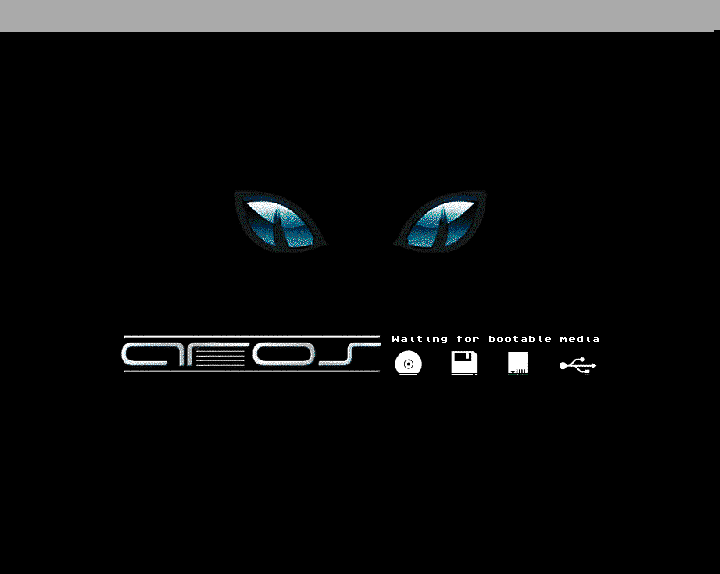

# Isolated RetroArch AROS smoke test

The unchanged Windows x64 PUAE core passed a bounded, diskless AROS boot test on 27 October 2026. RetroArch loaded the core, displayed the embedded AROS boot screen and its "Waiting for bootable media" message, ran for 3,000 frontend frames, and unloaded the core with process exit code 0.

Windows Computer Use was subsequently stopped by the user with the physical Escape key. Further UI input stopped at that point. Reset, save-state, load-state, and guest input acceptance are unverified.

## Environment and isolation

| Item | Value |
| --- | --- |
| Frontend | RetroArch 1.22.2, Git `69a4f0e`, official Windows x64 portable package |
| Frontend root | `C:\Projects\puae-runtime\RetroArch-Win64` |
| Frontend executable SHA256 | `81c11b6f24932bf7918f05eee8928035bff3887335fd2a081507c75e9d94d06a` |
| Core revision | `7387937066b1b693816c3b4e2b7a0c601d41363d` |
| Core SHA256 | `bcd4827e5138a14e22a39535754aea0d3913ef0404b636d1cc666476aa3c19e8` |
| Model | A1200, PAL, with the preset's 2 MB Chip and 8 MB Fast RAM |
| Kickstart selection | `auto`; no external ROM files supplied |
| Content | None |
| Video and audio drivers | Direct3D 11 and WASAPI |
| First profile | `C:\Projects\puae-runtime\profiles\01-aros-boot` |

Each run has a fresh profile with explicit system, content, save, state, screenshot, configuration, remap, playlist, cache, recording, and log directories. The frontend receives the profile through `--config`, and the core options have a dedicated file. Configuration saving on exit, history, automatic overrides/remaps/shaders, automatic states, rewind, and run-ahead are disabled for this smoke test. The portable application's bundled assets and core information are used; the existing Windows RetroArch profile is not used.

The profile system and content directories were empty before the completed test, and its system directory remained empty afterward. Global Windows PATH and registry settings were not changed. WHDLoad and global boot-hard-disk support were disabled. No game image, commercial Kickstart, CAPSIMG library, or checked-in HDF was mounted.

## Setup steps

1. Download the [official RetroArch 1.22.2 Windows x64 archive](https://buildbot.libretro.com/stable/1.22.2/windows/x86_64/RetroArch.7z), reached through the [official platform download page](https://www.retroarch.com/?page=platforms).
2. Record its SHA256 and inspect the archive paths before extraction. The downloaded archive is 202,509,078 bytes, SHA256 `b2139b1d0f9d4526dc6b5ce23cbb3efdc766096fa6f2c3df016818b486ac6372`. This is a locally recorded fingerprint; no separately published digest was compared.
3. Extract the portable archive into the new `C:\Projects\puae-runtime` directory using Windows `tar.exe -xf`. Confirm the executable version with `Start-Process -Wait` and redirected stdout. The captured CLI help documents the bounded-frame and screenshot switches.
4. Copy the compiled DLL into the portable frontend's `cores` directory after checking it against the preserved build hash.
5. Create a fresh profile with empty system/content directories and explicit frontend and core configuration files. Use the launcher below to preserve configuration copies, launch metadata, logs, exit status, core hashes, and the final core screenshot.

The official [CLI guide](https://docs.libretro.com/guides/cli-intro/) documents explicit configuration files, verbose logs, and loading a core. The exact help output from this downloaded executable is preserved in [help-stdout.txt](runtime/2026-10-27-aros-smoke/help-stdout.txt).

## Repeat the bounded boot test

From PowerShell:

```powershell
Set-Location C:\Projects\puae
.\scripts\Start-AROSSmoke.ps1 -RunName aros-repeat-01 -Model A1200 -MaxFrames 3000
```

The launcher opens an interactive window, waits for the bounded run to finish, and records the result. It refuses to overwrite existing profile/evidence directories or a runtime DLL that differs from the tested build. Its default is 6,000 frames; the completed boot test explicitly used 3,000. It is pinned to the original compiled DLL hash so a future source build requires a separately recorded baseline.

The effective frontend arguments are `--verbose --config <profile>/retroarch.cfg -L <portable>/cores/puae_libretro.dll --log-file=<evidence>/retroarch.log --max-frames=3000 --max-frames-ss --max-frames-ss-path=<evidence>/final-frame.png`. The exact paths and argument array are in [launch.json](runtime/2026-10-27-aros-smoke/01-aros-boot/launch.json).

## Completed boot result

| Check | Observation |
| --- | --- |
| Run | `01-aros-boot` |
| Start in Istanbul | 27 October 2026, 00:27:44 |
| Wall duration | 61.420 seconds |
| Frontend runtime log | 1 minute of content runtime |
| Frame bound | 3,000 frames |
| Core load | Window and log identify `PUAE 5.3.1 73879370` |
| ROM behavior | Expected `kick40068.A1200` missing warning, then visible embedded AROS boot output |
| Final screen | AROS logo and "Waiting for bootable media" |
| Video | D3D11 initialized; PAL 50 Hz; output geometry changed to 720 by 574 |
| Audio | WASAPI synchronous output initialized at 44,100 Hz; audible correctness was not assessed |
| Shutdown | Game, core, and core symbols unloaded; process exit code 0 |
| Binary preservation | Runtime DLL SHA256 unchanged after the run |
| External system files | None before or after the run |

The missing-Kickstart error is an expected trigger in this deliberately ROM-free profile. AROS reaches its waiting screen without external bootable media; this does not establish a Workbench desktop, game compatibility, or compatibility with commercial Kickstarts.



The screenshot is the core framebuffer captured by RetroArch at the bounded exit. The window was also visually inspected through Windows Computer Use during boot. An attempted F8 screenshot hotkey did not produce a recorded screenshot and is not counted as a successful input check.

## Interrupted interaction checks

A second fresh A1200 profile, `02-aros-reset-state`, was launched with a 6,000-frame limit for intended reset and state checks. Computer Use was stopped with the physical Escape key before those checks were verified. No further UI input was issued afterward. The bounded launch was left to finish or respond to the physical key; its process record and logs are preserved separately. Its outcome is not included in the completed smoke-test acceptance result.

Guest keyboard/mouse behavior, reset, state save/restore, rewind, media loading, WHDLoad persistence, audio output quality, other models/platforms, and original-machine fidelity remain outside the completed evidence. The next development gate is a separately authorized input/reset/state check or a test using known diagnostic media.

## Evidence

The [evidence directory](runtime/2026-10-27-aros-smoke/) contains the frontend acquisition receipt, archive listing, executable version and CLI help, copied configurations, exact launch arguments, verbose logs, run results, and screenshot. The primary completed result is [run-result.json](runtime/2026-10-27-aros-smoke/01-aros-boot/run-result.json) and [retroarch.log](runtime/2026-10-27-aros-smoke/01-aros-boot/retroarch.log). The [launcher](../scripts/Start-AROSSmoke.ps1) and runtime profile remain available locally. No emulator source edits, commits, or pushes were made.
