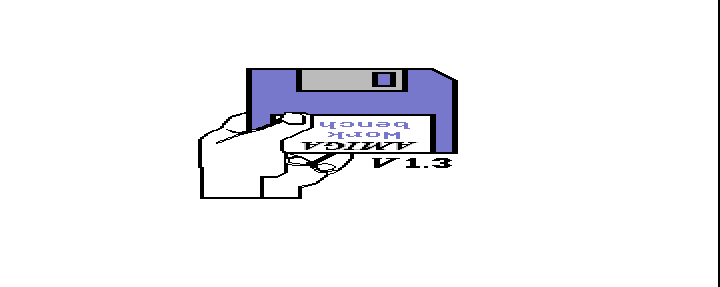
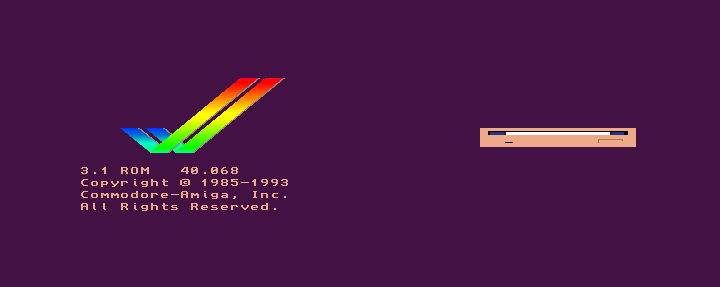

# Kickstart ROM setup and smoke tests

The supplied `C:\Users\Onur\Downloads\KickStartRoms.zip` was extracted on 27 October 2026 into `C:\Projects\puae-runtime\firmware\kickstarts`. All 12 ROM files match the MD5 values documented in the core README. The source ZIP is unchanged, and ROM bytes remain outside the repository.

The archive SHA256 is `7451f5a58fc1c812c76bdec69c2a5364a42d8d887770e5b38b56b4c3ca9afb8f`. Extraction ignored the archive's `__MACOSX` metadata. [manifest.json](runtime/kickstarts/manifest.json) records each filename, size, MD5, SHA256, expected MD5, and verification result.

## Isolation and launch

Each test uses a fresh RetroArch profile beneath `C:\Projects\puae-runtime\profiles\`. The launcher verifies the selected ROM against the extraction manifest and copies only that ROM into the new profile's system directory. It records the current core DLL hash and uses a separate runtime copy named by that hash. Existing AROS profiles, baseline DLLs, and screenshots remain intact.

Run a fresh bounded test from PowerShell:

```powershell
Set-Location C:\Projects\puae
.\scripts\Start-KickstartSmoke.ps1 -RunName kickstart-A500-repeat -Model A500 -MaxFrames 1500
.\scripts\Start-KickstartSmoke.ps1 -RunName kickstart-A1200-repeat -Model A1200 -MaxFrames 1500
```

Use a new run name for each invocation. The launcher defaults to `C:\Projects\puae\puae_libretro.dll`; pass `-CoreDll C:\Projects\puae\puae603_libretro.dll` for the integration candidate, and `-ColorDepth 24bit` for XRGB8888 rather than the default RGB565. The selected binary hash is recorded in each `launch.json`. Core option `puae_kickstart = "auto"` is retained, so the logs must confirm the matching external ROM rather than an AROS fallback. No boot disk or game content is supplied.

## Completed pre-integration baseline

Both runs below used the original compiled PUAE 5.3.1 core, SHA256 `bcd4827e5138a14e22a39535754aea0d3913ef0404b636d1cc666476aa3c19e8`. They establish the reference before the WinUAE 6.0.3 source integration; they do not validate the integration candidate.

| Run | ROM and MD5 | Bound and result | Visible output |
| --- | --- | --- | --- |
| `01-baseline-A500` | `kick34005.A500`, `82a21c1890cae844b3df741f2762d48d` | 1,500 frames, 31.108 seconds wall time, exit code 0 | Kickstart 1.3 hand and disk screen |
| `02-baseline-A1200` | `kick40068.A1200`, `646773759326fbac3b2311fd8c8793ee` | 1,500 frames, 31.105 seconds wall time, exit code 0 | Purple Kickstart 3.1 ROM 40.068 disk-insertion screen |

The logs explicitly report `Kickstart: "kick34005.A500"` and `Kickstart: "kick40068.A1200"`, respectively. Each core unloaded cleanly, and the runtime DLL hashes remained unchanged. No missing-ROM warning or AROS fallback was observed in these runs.





The [evidence directory](runtime/2026-10-27-kickstart-smoke/) contains configuration copies, exact arguments, ROM and core hashes, verbose logs, process results, and native framebuffer screenshots. These are bounded boot tests. Guest input, gameplay, disk I/O, state save/restore, audible output quality, and original-machine fidelity require separate checks. CD32, CDTV, and other ROM/model combinations have not been exercised.

## Completed WinUAE 6.0.3 release smoke tests

The optimized integration DLL is `C:\Projects\puae\puae603_libretro.dll`, SHA256 `38578cee10c58bfcb1dabdde4df8a76263c0efcb4e8cc466d0a704be438b61d2`. All four runs used this exact binary, a verified external Kickstart, and a fresh profile. Each ran for 1,500 frontend frames and exited cleanly.

| Run | Model / frontend format | Wall time | Result |
| --- | --- | --- | --- |
| `13-release-A500-16bit` | A500 / RGB565 | 31.139 s | Exit 0; expected boot screen |
| `14-release-A1200-16bit` | A1200 / RGB565 | 31.092 s | Exit 0; expected boot screen |
| `15-release-A500-24bit` | A500 / XRGB8888 | 30.987 s | Exit 0; expected boot screen |
| `16-release-A1200-24bit` | A1200 / XRGB8888 | 31.109 s | Exit 0; expected boot screen |

The A500 captures show the Kickstart 1.3 hand/disk screen. The A1200 captures show the purple Kickstart 3.1 ROM 40.068 screen with the disk-insertion animation. Both pixel formats were negotiated explicitly in the logs, and all four 720x287 final frames were visually inspected. AROS was not selected. The native renderer positions the artwork horizontally differently from the 5.3.1 references; these checks establish boot output, not pixel-for-pixel parity.

Candidate runs `03` through `10` are failed integration diagnostics, despite their process exit codes of 0. Runs `11` and `12` show the repaired renderer using temporary diagnostic optimization. Runs `13` through `16` above are the accepted optimized release checks. The missing lock/blanking-limit setup and empty-unlock handling were fixed before those accepted tests. Temporary logging and diagnostic compiler flags are absent from the final DLL.

[Machine-readable release results](upstream/2026-10-27-winuae/release-smoke-results.json) link the ROM/core/screenshot hashes and process results. [Integration details](upstream/2026-10-27-winuae/INTEGRATION_STATUS.md) record the source and build adaptations. [ROM reverification](runtime/kickstarts/reverification.json) confirms all twelve extracted files and the original ZIP remain unchanged.

These passes do not cover game/media boot, guest input, reset, save-state round trips, old-state compatibility, audible audio quality, advanced display modes/cropping, or other machines and platforms.
